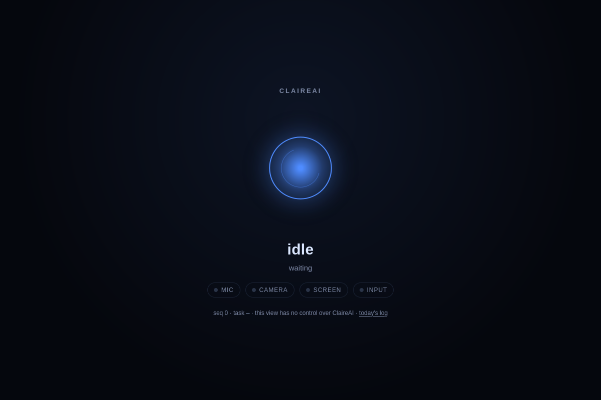

# ClaireAI

**A personal assistant that runs entirely on your own machine.** Local model inference, an append-only audit trail of every action, and file and browser tools that cannot act without your explicit approval.

No cloud provider. No API keys. Nothing leaves the laptop unless you allow it.



<p align="center">
  <a href="https://github.com/tres9lo/claireai/actions/workflows/python-tests.yml"></a>
  
  
  <a href="LICENSE"></a>
</p>

---

## Why this exists

Most assistants are a chat box wired to someone else's server. They read your files through an API, remember what you said on infrastructure you don't own, and ask you to trust that the model will behave.

ClaireAI takes the opposite position: **the model is untrusted, the runtime is the authority.** The model may only propose an action. The runtime validates the tool name, checks the arguments against a schema, applies a folder allow-list, consults the risk policy, asks you when a write is involved, then executes — and writes an audit row that the database itself refuses to let you edit.

The result is an assistant you can actually point at real folders, because the blast radius is defined in code rather than in a prompt.

## The plan, stated plainly

ClaireAI is built around one idea: **you should own the assistant and the data it touches.** Three things follow from that, in this order.

1. **A small local model I train myself.** The default brain is a from-scratch transformer trained on this machine, in `brain-lab/`. It is small on purpose: it fits in RAM on a laptop with no GPU, it runs with the network cable unplugged, and nothing it reads is sent anywhere. Today it holds short conversations, does simple arithmetic, routes intents, extracts slots, emits tool-call JSON and refuses the unsafe requests covered in this repository. It is not a general-purpose assistant, and this README will not pretend otherwise.
2. **Connectors, for when I want more brain than my laptop can hold.** The `Brain` interface is deliberately provider-neutral, and it now has three adapters: Claude, ChatGPT and a larger model served by Ollama. **They are opt-in and off by default.** The local checkpoint answers unless you set one, the audit row names the provider that answered, and the validation, folder allow-list, approval flow and audit log do not change, because the model was never the thing enforcing them. Setup and the honest limits are in [docs/connectors.md](docs/connectors.md).
3. **An assistant I do not have to worry about.** Deny-by-default folders, no permanent deletes, approvals a model cannot fake, an audit log the database will not let you edit, and inference that never leaves the machine. That is the property worth having, and it is where most of the effort in this project goes.

### On the model work, honestly

I am not a model-training expert. I am learning this in public: every training run in this repository is measured, and the runs that did not work are documented in [PROGRESS.md](PROGRESS.md) rather than quietly deleted. If you know more about training small transformers than I do — data mixing, curriculum, tokenizer design, evaluation that is more than loss going down — I would genuinely like your pointers. Open an issue with what you would change, or a pull request that makes the numbers better; both are the fastest way to move this project forward.

## What works today

| Capability | Status |
| --- | --- |
| From-scratch byte tokenizer and decoder-only transformer research model | ✅ foundation |
| SQLite storage with a versioned, checksummed migration runner | ✅ |
| Append-only audit log (`task_log`), enforced by database triggers | ✅ |
| Provider-neutral `Brain` interface + local scratch-checkpoint adapter | ✅ foundation |
| Opt-in Claude, ChatGPT and Ollama connectors (local model stays the default) | ✅ scratch remains default |
| CLI chat that records every turn as a task plus audit entries | ✅ |
| 6 read-only tools (list, info, read, search, largest, calendar listing) | ✅ |
| 8 approval-gated writes (create, write, rename, move, trash, download, add appointment) | ✅ |
| Interactive approval flow with per-decision audit references | ✅ |
| Agent loop with schema validation, risk policy and step cap | ✅ |
| Deterministic tool routing (roughly halves prompt tokens per step) | ✅ |
| Daily summary (Done / Failed / Pending) from the task log | ✅ |
| Dates and times answered from the clock; `yesterday`/`last friday` accepted by the summary | ✅ deterministic, no model call |
| Workspace calendar: appointments in SQLite, `what's on tomorrow` answered from them | ✅ listing is read-only, adding needs approval |
| Read-only `/today` page served over loopback | ✅ |
| Retention/pruning for trash and summaries | ✅ |
| Presence HUD (canvas 2D, loopback preview) | ✅ |
| Browser tools, disabled until enabled in the local control panel | ✅ |
| Runtime stop switch and browser access control panel | ✅ first version |
| Local web chat, stored conversation history, owner directives and UI preferences | ✅ first version |
| Offline speech output with UI pitch/rate controls | ✅ Piper neural voice, else eSpeak NG |
| Push-to-talk local speech transcription in the HUD | ✅ first version; optional Whisper weights installed from the UI |
| OS family detection (Linux/Windows first targets) | ✅ detection only |
| Reproducible MIT synthetic task corpus + split-aware text training | ✅ starter data |
| Random-init visual-grounding prototype using attributed online synthetic images | 🧪 research only; not integrated |
| Capable scratch-trained assistant; speech recognition and custom trained voice | 🚧 not included yet |
| FastAPI service · Playwright engine · Tauri desktop shell | 🚧 planned |
| Camera, screen, cursor and keyboard control | 🚧 specified, not built |

The project is at **Month 1 of its roadmap** and has not had a public release. See [ROADMAP.md](ROADMAP.md) for the plan and [PROGRESS.md](PROGRESS.md) for verified results and open blockers.

## How a request flows

```
you (terminal)
  │  "List the biggest files in my Downloads folder"
  ▼
claireai.cli ──► claireai.agent.run_task
  │                 │
  │                 ├─ tasks.create()          → queued → running
  │                 ├─ presence.emit("thinking")
  │                 ▼
  │            loop (≤ 8 steps)
  │                 ├─ brain.generate(messages, tools) ──► locally trained PyTorch checkpoint
  │                 ├─ no tool call → answer, status = succeeded
  │                 └─ tool call →
  │                      1. registry lookup      unknown → refused
  │                      2. validate arguments   bad schema → refused
  │                      3. risk policy          above safe → approval
  │                      4. approval decision    CLI prompt or deny
  │                      5. sandboxed execution  allow-list enforced
  │                      6. audit row            append-only
  ▼
answer + full trail in SQLite
```

Every step is a row: the tool, its arguments, the resolved target, the status, and the approval reference that authorised it.

## The safety model

This is the part worth reviewing before you run it.

- **Deny by default.** `CLAIREAI_ALLOWED_FOLDERS` is empty out of the box. With no entries, every file tool is refused.
- **Paths are resolved in code.** Symlinks are followed, and a link inside a trusted folder that points outside it is refused.
- **Arguments are validated, not trusted.** Each tool declares a pydantic schema; unexpected keys are rejected rather than ignored.
- **Writes ask first.** The exact tool, arguments and target are printed, and only an explicit `y`/`yes` approves. Piping input into the CLI cannot approve anything — a non-interactive run refuses and says why.
- **The audit log is append-only at the database level.** Triggers reject `UPDATE` and `DELETE`; retention reports the log instead of pruning it.
- **Nothing is deleted permanently.** `move_to_trash` relocates into ClaireAI's own recoverable bin.
- **Task and audit logs redact secrets.** Full user and assistant messages are retained verbatim in the local conversation database so ClaireAI can show history and continue chats. The owner can review or delete conversations from the UI; the database is owner-readable only on POSIX systems.
- **Inference is local by default.** ClaireAI loads its own checkpoint and, out of the box, calls no hosted model API. A connector is an explicit setting the owner writes (`CLAIREAI_BRAIN_PROVIDER`), it is opt-in per provider, and the audit row for the turn records which one answered. A remote model can only *propose* a tool call — approvals and the sandbox still decide what runs.
- **Capabilities are opt-in.** Browser access starts disabled. The local HUD can enable it; browser actions still use the existing approval path. Stop ends model generation between tokens, lets a current bounded tool action finish, prevents subsequent model/tool calls, and exits the interactive CLI even while it is waiting for input. The HUD remains available; after allowing the runtime again, start ClaireAI from the CLI.

Read [docs/architecture/threat-model.md](docs/architecture/threat-model.md) for the full boundary analysis.

## Quick start (Linux)

Requires **Python 3.11+** and PyTorch. The scratch model starts with random weights; it is a research prototype and will not behave like a capable assistant until trained and evaluated on substantial task-specific data.

```bash
git clone https://github.com/tres9lo/claireai.git
cd claireai

# 1. Python environment
uv venv --seed --python 3.12 assistant/.venv
uv pip install --python assistant/.venv/bin/python --index-url https://download.pytorch.org/whl/cpu torch
uv pip install --python assistant/.venv/bin/python -e "assistant[dev,model]"
uv pip install --python assistant/.venv/bin/python -e ./brain-lab

# Speech output. Piper is a neural voice and sounds like a person; eSpeak NG is
# the fallback and always works. Neither one sends audio anywhere.
uv pip install --python assistant/.venv/bin/python piper-tts
sudo apt install pulseaudio-utils            # for paplay; espeak-ng as fallback

# Voice models (~61 MB each). Download the ones you want into:
#   ./runtime-data/models/voice/piper/  (or set CLAIREAI_PIPER_DIR)
#   https://huggingface.co/rhasspy/piper-voices  →  en/en_US/lessac/medium,
#   fr/fr_FR/siwis/medium. Each voice needs its .onnx and .onnx.json side by side.

# 2. Build the conversation corpus and train the chat model.  The included
#    synthetic starter exercises the pipeline but is not enough for a generally
#    capable assistant; add licensed Dolly 15k / TinyStories files under
#    brain-lab/data/external/chat-sources/ for broader language.  The builder
#    records every source and hash.
export CLAIREAI_DATA_DIR=./runtime-data
assistant/.venv/bin/python brain-lab/build_chat_dataset.py
# Warm start from an existing checkpoint: reuse its BPE merges (`--init-from`
# does that automatically) and keep its architecture, or the weights will not fit.
assistant/.venv/bin/python brain-lab/train_chat.py \
  --corpus brain-lab/data/chat-v6 --steps 3000 \
  --init-from runtime-data/models/claire-chat-v4.pt \
  --context 288 --vocab-size 1152 --width 224 --layers 5 --heads 7 \
  --output runtime-data/models/claire-chat-v6.pt
# Start the app: chat, history, preferences, approvals, controls. One command.
./scripts/start.sh

# 3. Ask one question; the turn is logged to SQLite
CLAIREAI_DATA_DIR=./runtime-data \
  assistant/.venv/bin/python -m claireai.cli --once "Hello"

# 4. Let the model use read-only file tools (allow-list required)
CLAIREAI_DATA_DIR=./runtime-data \
CLAIREAI_ALLOWED_FOLDERS='["~/Downloads"]' \
  assistant/.venv/bin/python -m claireai.cli --once "List the biggest files in my Downloads folder"
```

Windows setup uses the same Python and CPU training path; see [docs/setup/windows.md](docs/setup/windows.md).

### The desktop app

The native window is built on Tk with customtkinter for its surfaces: no
browser, no loopback web server, no JavaScript. It opens on **Chat** and has
seven separate screens in the sidebar — Chat, Activity, Approvals, History,
Voice, Settings and About — each with its own job rather than one long page.

Design tokens live in `desktop/theme.py`: one accent colour, rounded surfaces,
and motion timed from the wall clock rather than a frame count, so a slow
machine drops frames instead of playing every animation in slow motion. The
selected sidebar pill eases between pages, the status dot breathes, the chat
shows a live thinking indicator, and each page fades its surface in.

```bash
assistant/.venv/bin/claireai-desktop      # or: ./scripts/start.sh --desktop
```

- **Chat** runs real agent turns; write actions wait in **Approvals** until you
  press Approve, and the sidebar shows how many are waiting.
- **Activity** lists every task with its status, and the error text when one failed.
- **Voice** speaks in English or French (the language is detected from the text,
  or chosen by hand), and records from the microphone when a speech model is
  installed.
- **Settings** holds the same preferences as the web UI, including the emergency
  stop switch; it shares the same database, so the CLI sees them immediately.

The window can start with your session: `claireai --install-autostart` writes
`~/.config/autostart/claireai.desktop`, which is the only file it ever adds
there, and `--uninstall-autostart` removes exactly that file.

### Granting a folder

```bash
export CLAIREAI_ALLOWED_FOLDERS='["~/Downloads", "~/Documents"]'
```

Only those trees are visible to the file tools. Everything else is refused.

### Everyday commands

```bash
# Interactive session
assistant/.venv/bin/python -m claireai.cli

# Plain chat, no tools
assistant/.venv/bin/python -m claireai.cli --no-tools

# Show which tools would be called, without running them
assistant/.venv/bin/python -m claireai.cli --dry-run "clean up my downloads"

# Today's summary, printed and saved (no model needed)
assistant/.venv/bin/python -m claireai.cli --summary

# Daily summary at 18:00 local time
assistant/.venv/bin/python -m claireai.cli --summary-at 18:00

# The whole app in one command (creates the venv on first run, then opens it)
./scripts/start.sh

# The native desktop window: no browser, no local web server
./scripts/start.sh --desktop

# Start ClaireAI with your desktop session (XDG autostart), and undo it
assistant/.venv/bin/claireai --install-autostart
assistant/.venv/bin/claireai --autostart-status
assistant/.venv/bin/claireai --uninstall-autostart

# Same thing without opening a browser, or on another port
./scripts/start.sh --no-browser
./scripts/start.sh --port 9000

# Terminal chat instead of the app
./scripts/start.sh --cli

# Self-improvement: enable it in the HUD, then train an isolated candidate
assistant/.venv/bin/python brain-lab/train.py brain-lab/data/bootstrap-v1/text --steps 200 --improvement

# Diagnostics
assistant/.venv/bin/python scripts/doctor.py

# Optional visual prototype (downloaded image data; kept separate from chat)
uv pip install --python assistant/.venv/bin/python -e "brain-lab[vision]"
assistant/.venv/bin/python brain-lab/vision_train.py --epochs 20
```

## Architecture

```
assistant/      Python runtime: config, storage, audit, brain, tools, CLI
desktop/        Presence HUD (canvas 2D) and the future Tauri shell
docs/           Setup, architecture, platform support, licenses
scripts/        doctor.py, eval_model.py, conversation_eval.py, smoke.py, presence_preview.py
runtime-data/   Local only, git-ignored: databases, logs, downloads, trash
```

The runtime is deliberately modular: `brain` never imports a tool, `tools` never import the agent, and `presence` holds no capability. A full module-by-module map is in [docs/architecture/overview.md](docs/architecture/overview.md).

### Why tool routing

Re-sending every tool schema on every loop step is the dominant cost on a CPU-only machine. `claireai.routing` narrows the schemas a request can reach using deterministic keyword intent — no model call — and measured roughly **50–60% fewer prompt tokens** on three requests with no change in tool choice. Routing changes what the model *sees*, never what is *allowed*: validation, the allow-list and approvals still run against the full registry.

## Testing

```bash
cd assistant && python -m pytest        # unit + security tests
assistant/.venv/bin/python scripts/smoke.py --skip-model   # end-to-end, no model
assistant/.venv/bin/python scripts/smoke.py                # full run, needs a trained checkpoint
```

CI runs the portable unit suite on Ubuntu and Windows across Python 3.11 and 3.12. The 14-check smoke script verifies the real loop: migrations, a chat turn, tool execution, a refused write, the presence stream, the daily summary, the read-only page, retention, and that the audit log rejects mutation.

Model behaviour is measured, not assumed: `scripts/eval_model.py` scores the local model against fixed cases before features depend on it, `conversation_eval.py` scores multi-turn answers, and `tool_call_eval.py` scores whether the configured brain proposes tool calls the runtime can actually read:

```bash
assistant/.venv/bin/python scripts/tool_call_eval.py --runs 3
```

## Documentation

| Document | Contents |
| --- | --- |
| [docs/setup/linux.md](docs/setup/linux.md) | Install and first run on Linux |
| [docs/setup/windows.md](docs/setup/windows.md) | Install and first run on Windows |
| [docs/architecture/overview.md](docs/architecture/overview.md) | Module map and request lifecycle |
| [docs/architecture/threat-model.md](docs/architecture/threat-model.md) | Trust boundaries and abuse cases |
| [docs/architecture/approval-from-the-page.md](docs/architecture/approval-from-the-page.md) | Why approvals are not a web button |
| [docs/architecture/presence-renderer.md](docs/architecture/presence-renderer.md) | The assistant's visual state contract |
| [docs/architecture/machine-access.md](docs/architecture/machine-access.md) | Camera, screen and input policy |
| [docs/connectors.md](docs/connectors.md) | Opt-in Claude, ChatGPT and Ollama brains |
| [docs/platform-support.md](docs/platform-support.md) | What is verified on which OS |
| [ROADMAP.md](ROADMAP.md) | Phased plan |
| [PROGRESS.md](PROGRESS.md) | Current state, measurements, blockers |
| [CHANGELOG.md](CHANGELOG.md) | Notable changes |

## Contributing

Issues and pull requests are welcome. Please read [CONTRIBUTING.md](CONTRIBUTING.md) and [SECURITY.md](SECURITY.md) first — changes that touch the permission layer, the audit log or the sandbox need tests that prove the refusal path still holds.

## License

[MIT](LICENSE). Bundled model and third-party data licences are listed in [docs/model-and-data-licenses.md](docs/model-and-data-licenses.md).
